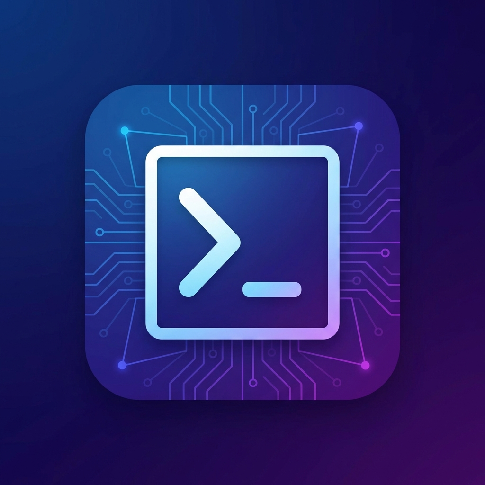
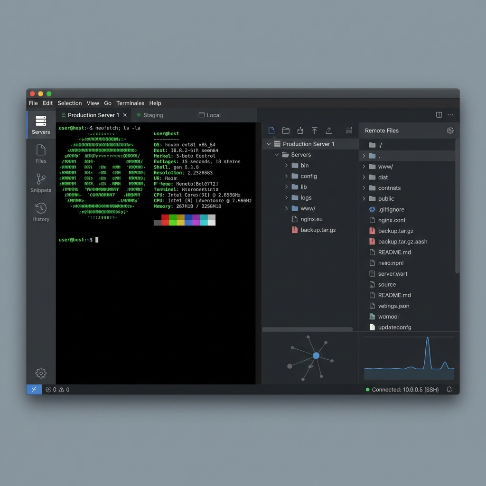

<div align="center">



# OpenMoba Term

**Gestor de sesiones multi-protocolo: SSH, SFTP, RDP y VNC en una sola aplicación de escritorio.**

[](https://github.com/AgustinBouzonn/open-moba-term/actions/workflows/ci.yml)
[](https://github.com/AgustinBouzonn/open-moba-term/releases/latest)
[](LICENSE)
[](https://github.com/AgustinBouzonn/open-moba-term/releases/latest)
[](https://www.electronjs.org/)
[](https://www.typescriptlang.org/)

[Descargar](#descarga) · [Reportar un bug](https://github.com/AgustinBouzonn/open-moba-term/issues/new?template=bug_report.md) · [Pedir una feature](https://github.com/AgustinBouzonn/open-moba-term/issues/new?template=feature_request.md)

</div>

<div align="center">
  
  <sub>Sesiones SSH, RDP y VNC en una misma interfaz con pestañas.</sub>
</div>

## Qué es

OpenMoba es un gestor de conexiones remotas libre y de código abierto, pensado para administradores de sistemas, developers y equipos de DevOps. Reúne en una sola app lo que normalmente requiere varias herramientas: una terminal SSH, un explorador de archivos SFTP y visores de escritorio remoto RDP y VNC.

## Características

| Protocolo | Qué ofrece | Implementación |
|---|---|---|
| **SSH** | Terminal completa con colores, copiar y pegar y redimensionado | `ssh2` + `xterm.js` |
| **SFTP** | Explorador de archivos con subida y descarga por arrastrar y soltar | `ssh2` |
| **RDP** | Conexión a escritorios y servidores Windows | `node-rdpjs` |
| **VNC** | Escritorio remoto para Linux, macOS y Windows | `rfb2` |

- 📑 **Pestañas:** muchas conexiones abiertas a la vez.
- 💾 **Sesiones guardadas:** conexión rápida a tus servidores habituales.
- 🔒 **Credenciales seguras:** se guardan en el llavero del sistema operativo con `keytar` (Credential Manager en Windows, Keychain en macOS y libsecret en Linux).
- ⚡ **Rendimiento:** los protocolos corren en un proceso aparte, así la interfaz no se congela.

## Descarga

Los instaladores de cada versión están en [Releases](https://github.com/AgustinBouzonn/open-moba-term/releases/latest).

| Plataforma | Archivo | Formato |
|---|---|---|
| **Windows** (x64) | `OpenMoba-<versión>-Setup.exe` | Instalador NSIS |
| **macOS** (Apple Silicon) | `OpenMoba-<versión>-arm64.dmg` | Imagen de disco |
| **Linux** | `OpenMoba-<versión>.AppImage` | AppImage, para cualquier distro |
| **Debian / Ubuntu** | `openmoba_<versión>_amd64.deb` | Paquete `.deb` |

## Instalación

**Windows.** Ejecutá el instalador. Como el binario no está firmado, SmartScreen puede mostrar una advertencia: elegí *Más información* y después *Ejecutar de todas formas*.

**macOS.** Abrí el `.dmg` y arrastrá OpenMoba a Aplicaciones. Como la app no está notarizada, la primera vez abrila con clic derecho y *Abrir*.

**Linux.**

```bash
# AppImage
chmod +x OpenMoba-*.AppImage
./OpenMoba-*.AppImage

# Debian / Ubuntu
sudo dpkg -i openmoba_*_amd64.deb
```

La [guía de inicio rápido](QUICKSTART.md) explica cómo crear tu primera conexión.

## Arquitectura

OpenMoba separa la interfaz de las conexiones en procesos distintos:

- **Proceso principal (Electron):** ventanas, IPC y almacenamiento seguro de credenciales.
- **Renderer (React + Zustand):** la interfaz, la terminal `xterm.js` y los visores RDP y VNC.
- **Worker:** ejecuta los servicios SSH, SFTP, RDP y VNC fuera de la interfaz.
- **IPC:** el renderer y el worker se comunican por `MessageChannel`, con baja latencia y sin pasar cada mensaje por el proceso principal.

```
src/
├── main/        Proceso principal: ventana, IPC, store y SecurityManager (keytar)
├── preload/     Puente seguro entre el proceso principal y el renderer
├── renderer/    Interfaz React: terminal, SFTP, visores RDP/VNC y sesiones
└── worker/      Servicios de protocolo: ssh/, rdp/ y vnc/
```

## Desarrollo

Requisitos: **Node.js 18 o superior** y Git.

```bash
git clone https://github.com/AgustinBouzonn/open-moba-term.git
cd open-moba-term
npm install    # también aplica los parches de patches/ y recompila los módulos nativos
npm run dev
```

| Script | Qué hace |
|---|---|
| `npm run dev` | Levanta la app en modo desarrollo con Vite |
| `npm run lint` | Corre ESLint sobre el proyecto |
| `npm run build` | Compila y empaqueta para el sistema operativo actual |
| `npm run build:win` / `build:mac` / `build:linux` | Empaqueta para una plataforma específica |
| `npm run dist:dir` | Genera la app sin instalador, útil para probar el empaquetado |

Los paquetes quedan en la carpeta `release/`. En `patches/` hay ajustes a `node-rdpjs` y `rfb2` que `patch-package` aplica automáticamente al instalar.

## Documentación

- [Guía de inicio rápido](QUICKSTART.md)
- [Preguntas frecuentes](docs/FAQ.md)
- [Roadmap](ROADMAP.md) y [Changelog](CHANGELOG.md)
- [Política de seguridad](SECURITY.md)

Documentos de diseño técnico, en formato RFC. Describen la arquitectura objetivo, que puede ir más allá de lo implementado hoy:

- [Arquitectura general](docs/MASTER_ARCHITECTURE.md) y [arquitectura del núcleo](docs/CORE_ARCHITECTURE.md)
- [Red y SSH](docs/NETWORKING_SSH.md), [motor de terminal](docs/TERMINAL_ENGINE.md) y [SFTP y sistema de archivos virtual](docs/VFS_SFTP.md)
- [Protocolos visuales RDP y VNC](docs/VISUAL_PROTOCOLS.md), [puente X11](docs/X11_BRIDGE.md), [persistencia](docs/PERSISTENCE.md) y [seguridad y criptografía](docs/SECURITY.md)

## Contribuir

Las contribuciones son bienvenidas. Antes de empezar, leé la [guía de contribución](CONTRIBUTING.md).

1. Hacé un fork del repositorio.
2. Creá una rama para tu cambio: `git checkout -b feature/mi-cambio`.
3. Commiteá siguiendo [Conventional Commits](https://www.conventionalcommits.org/es/): `git commit -m "feat: agrega X"`.
4. Subí la rama y abrí un pull request.

## Licencia

Distribuido bajo la licencia **GPL-3.0**. El texto completo está en [LICENSE](LICENSE).

## Agradecimientos

[xterm.js](https://xtermjs.org/), [ssh2](https://github.com/mscdex/ssh2), [node-rdpjs](https://github.com/citronneur/node-rdpjs), [rfb2](https://github.com/sidorares/node-rfb2) y [Electron](https://www.electronjs.org/), que hacen posible este proyecto.
